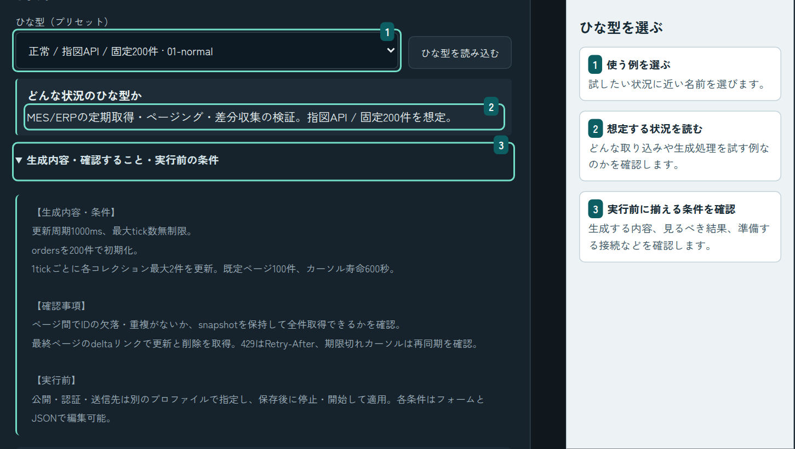
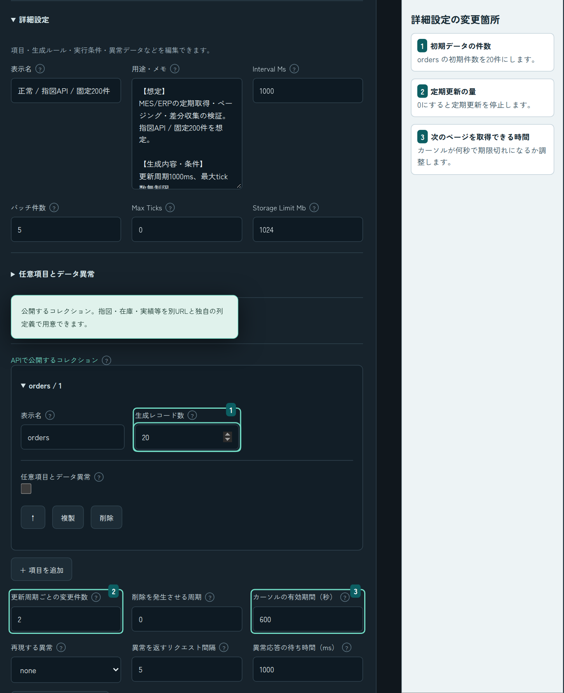
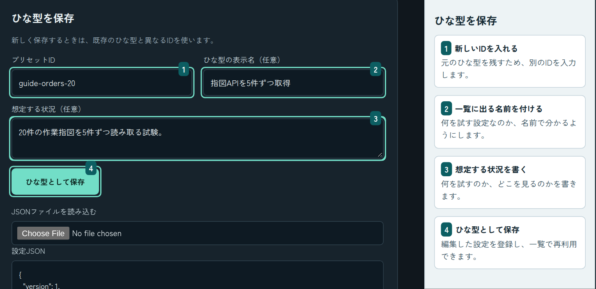

# 業務APIシミュレーターのひな型と詳細設定

ひな型（プリセット）は、生成するデータの項目・件数・書式や、再現したい異常をまとめた設定です。試したい状況に近いひな型を読み込み、見本を確認してから必要な設定を変えます。公開、書き込み、送信を始めるときは、画面の実行ボタンを使います。

## ひな型を選ぶ

**正常 / 指図API / 固定200件（01-normal）** を例にします。

MES／ERPの作業指図を定期取得し、ページをまたいでもIDが欠けたり重複したりしないか調べる場面です。元の例は orders を200件用意し、更新周期ごとに値も変わります。

「基本設定」でひな型を選び、「ひな型を読み込む」を押します。

「どんな状況のひな型か」で用途を確認し、「生成内容・確認すること・実行前の条件」で作るデータや準備を読みます。

429応答の後に収集側が待って再試行するか確認したい場合は「異常 / 429 Rate Limit（13-anomaly）」を選びます。

全ひな型の用途は[プリセット一覧](../presets/README.md)を参照してください。

## 詳細設定を変更して見本を見る

「詳細設定 → 業務APIの設定 → orders / 1」を開き、「生成レコード数」を200から20にします。「基本設定」の「1ページの件数」を5にします。

| 設定 | 変えられること |
| --- | --- |
| コレクション | 取得URLに現れる名前と初期件数を決めます。 |
| 更新周期ごとの変更件数 | 各周期で変更するレコード数です。0は定期更新なしです。 |
| カーソルの有効期間（秒） | 次のページの継続取得に使うカーソルの有効期間です。 |

**見本での確認**　「取得例を見る」で、orders の初期件数が20件、RESTの limit とODataの $top が5になったことを確認します。次ページや差分リンクは隔離した環境で公開して確認します。

## 自分のひな型を作って保存する

1. 上の例で編集した設定を残すには、「設定を保存・JSONで編集」を押します。今の設定がJSON欄に入った保存画面が開きます。
2. 「プリセットID」に `guide-orders-20` のような新しいIDを入力します。半角英数字、ハイフン、下線が使えます。同じIDで保存すると、そのひな型を更新します。
3. 必要に応じて表示名と想定する状況を入力し、「ひな型として保存」を押します。画面で編集した設定は、JSON欄を書き直さず保存できます。
4. 生成画面の「基本設定」に戻り、新しく保存したIDを選んで「ひな型を読み込む」を押します。見本を出し、変更した条件が戻っていることを確認します。

たとえば前回取得を中断したあとの再開だけを試す場合は、上の指図APIのひな型を読み込み、「更新周期ごとの変更件数」を `0` にしてデータを固定します。「カーソルの有効期間（秒）」を短くして、期限が切れたときに収集側が先頭から取得し直せるかを検証します。件数と有効期間を見本で確認してから別のIDで保存します。

共有するひな型には「指図APIを5件ずつ取得」のような表示名と、「20件の作業指図を5件ずつ読み取る試験。」のような用途を書いておくと、次の人が選びやすくなります。接続先と認証は「公開・出力設定」で管理します。ひな型を別環境で使う場合は「JSONを書き出す」で持ち出し、利用先で接続設定を選び直します。

[操作ガイドに戻る](../README.md#操作ガイド)
