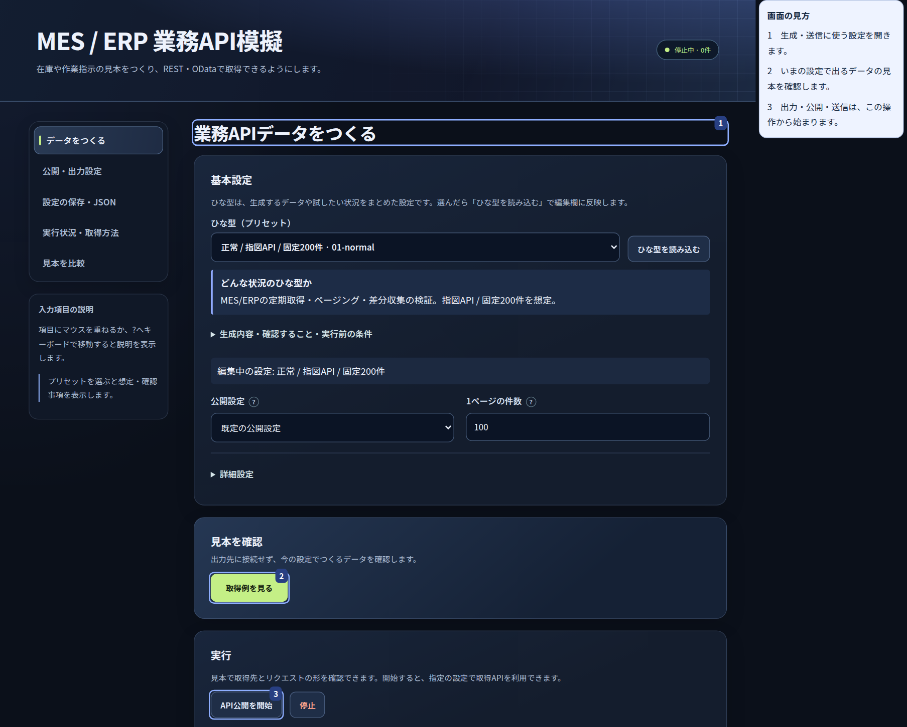

# 業務APIシミュレーター 操作マニュアル

収集側が、RESTまたはODataから作業指図や在庫を定期取得できるか検証します。アプリが合成データをSQLiteへ保存し、収集側はHTTP GETで読み取ります。

## 起動してから結果が出るまで

「取得例を見る」はリクエスト例とサンプルを作ります。「API公開を開始」で選んだコレクションを初期化し、公開設定に沿って読めるようになります。実行中は設定した周期で行を更新・削除できます。

## まず小さく試す

VMで準備する場合は[Docker Compose導入手順](vm-compose.md)で起動し、Web画面を開きます。

1. 「正常 / 指図API / 固定200件」のひな型を読み込みます。「詳細設定」の `orders` で件数を20にし、更新周期ごとの変更件数を0にすると、ページ取り込みだけを切り分けられます。
2. 「取得例を見る」で `orders` と件数、公開設定に対応する認証ヘッダーを確認します。
3. 「API公開を開始」を押し、`http://127.0.0.1:3641/source/rest/orders?limit=5` から取得します。応答の `next` を順にたどり、20件のIDを重複なく取得できることを確認します。認証付きの公開設定では指定された認証ヘッダーを付けます。
4. 変更取り込みの試験では更新を有効にし、最終ページの `delta` を保存して次の収集で使います。カーソルが失効した場合は先頭から取得し直します。

## 停止と再起動

「実行状況・取得方法」で停止します。再起動時は停止状態で、設定とSQLiteのデータはボリュームに残ります。公開再開時は対象コレクションと認証を確認します。

## 想定した結果が出ないとき

画面が開くのに収集できない場合は、公開を開始したか、コレクション名と認証が一致するかを確認します。429応答のひな型では `Retry-After` と収集側の再試行を照合します。

## ひな型・詳細設定

[ひな型を作る・見本を比較する](preset-guide.md)には設定例と注釈付き画像があります。各ひな型の一覧は[プリセット一覧](../presets/README.md)にあります。
